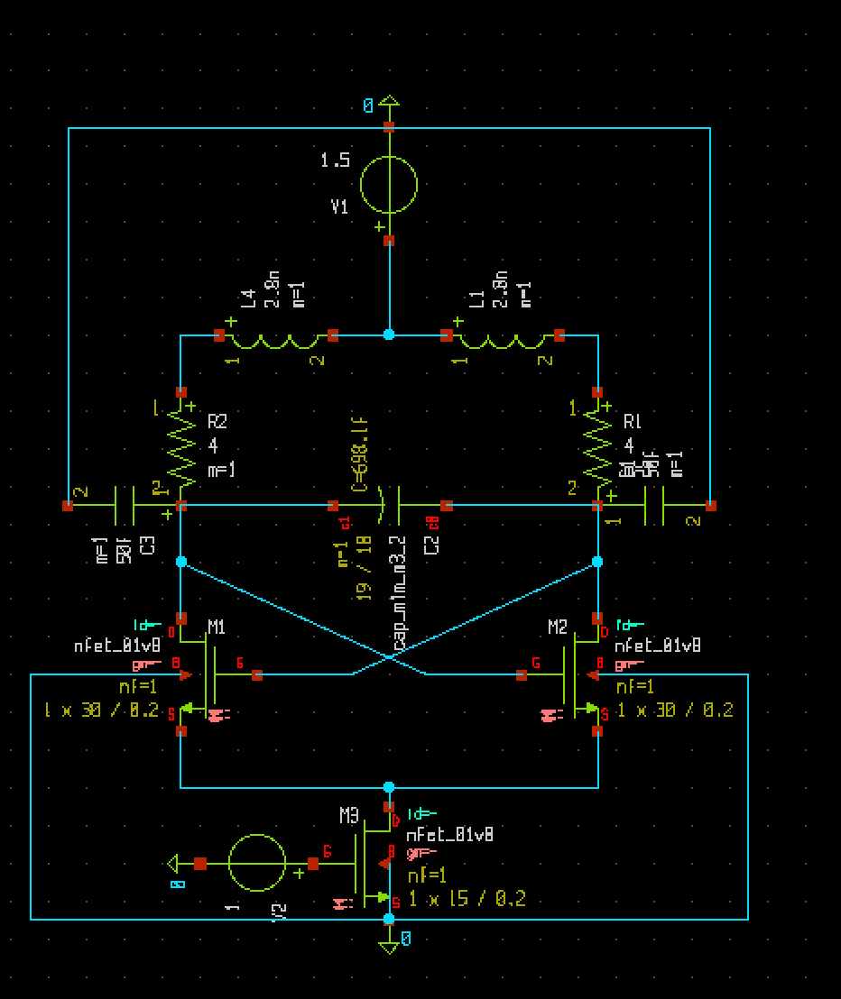
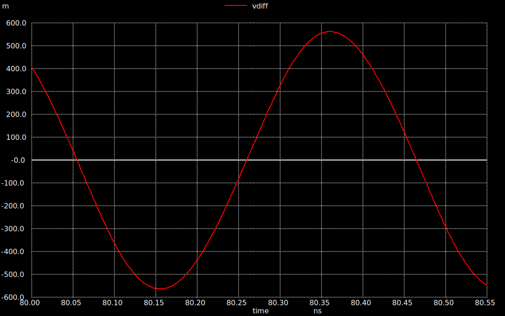
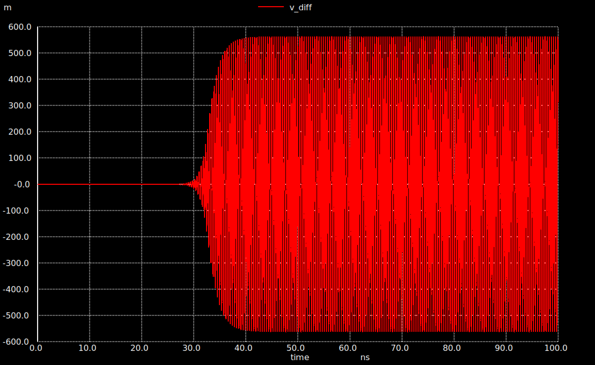

# Design 2.4GHz Low-Power LC-VCO
Full flow design and layout of a 2.4 GHz Low-Power LC-VCO using CMOS technology
## Introduction
This project will implement an **LC-VCO**_(Inductor-Capacitor Voltage-Controlled Oscillator)_ in the Skywater SKY130B 130nm open-source CMOS PDK, using a fully open-source EDA flow. 
The objective is to design an oscillator circuit that meets the initial specifications. Subsequently, efforts will be made to upgrade the topologies to further improve and optimize those parameters.
### EDA tools used
1. xschem
2. ngspice
3. netgen
4. magic vlsi
## Design an LC-VCO
### Specifications
| Parameter | Target |
|---|---|
| Supply Voltage | 1.5 V |
| Power Consumption | ≤ 1.5 mW |
| Center Frequency | 2.45 GHz |
| Frequency Range | 2.35–2.55 GHz |
| Frequency Tuning Range | ≥ 8.16% |
| Control Voltage | 0.1–1.2 V |
| Average Kvco | 150–250 MHz/V |
| Phase Noise @ 1 MHz | ≤ -105 dBc/Hz |
| Startup Time | ≤ 50 ns |
| Figure of Merit | ≥ 172 dB |
| Output Load | 50 fF/node |
> These are the initial specifications set up for the design, prior to any improvements or optimizations.
### Baseline LC Oscillator
Prior to designing LC-VCO, i decided to build the LC oscillator ciruit first. Upon completion, the measured parameters proved quite promising.
#### Schematic

#### Plots
| Waveform | Startup Time |
| :---: | :---: |
|  |  |
#### LCO's measured specifications
| Parameter | Value |
|---|---|
| Supply Voltage |1.5 V &nbsp;&nbsp;&nbsp; |
| Power Consumption | ≤ 1.38 mW (excluded $P_{bias}$) |
| Center Frequency | 2.44 GHz |
| Startup Time | 40 ns |
| Output Load | 50 fF/node |

**Note:** The inductor quality factor is estimated as $Q_L = \frac{2\pi fL}{R_s} = \frac{2\pi \times 2.44\,\text{GHz} \times 2.8\,\text{nH}}{4\,\Omega}$, yielding approximately 10.7 at 2.44 GHz 

